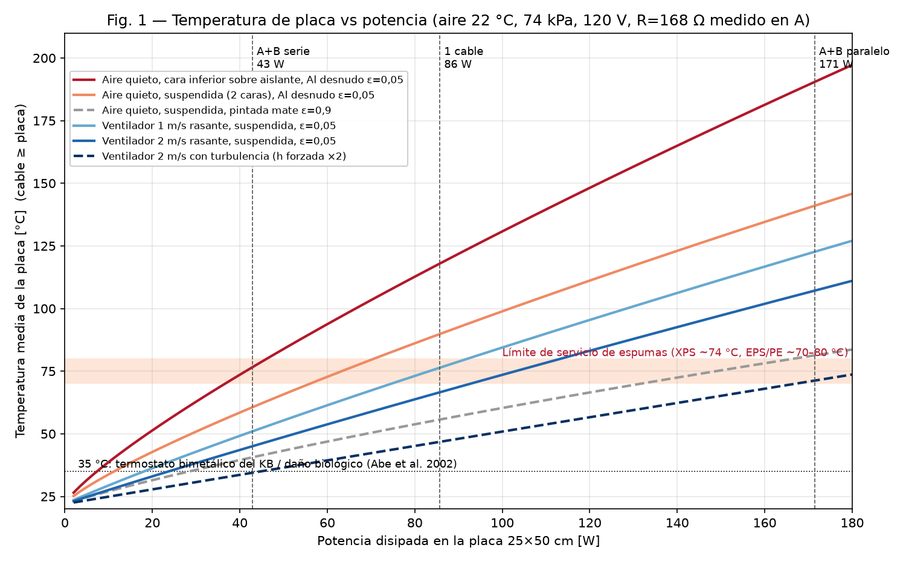
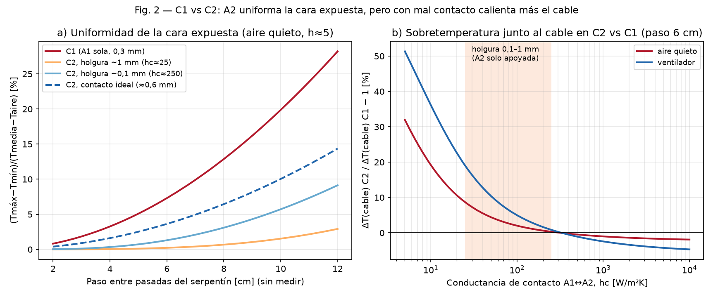
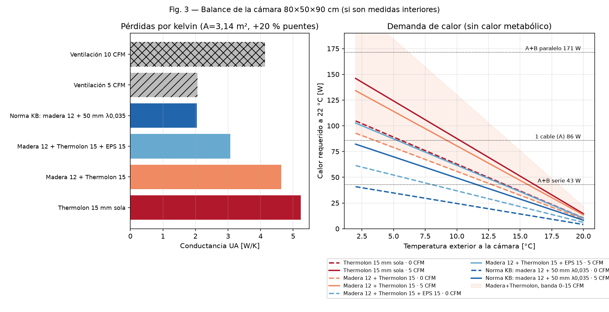
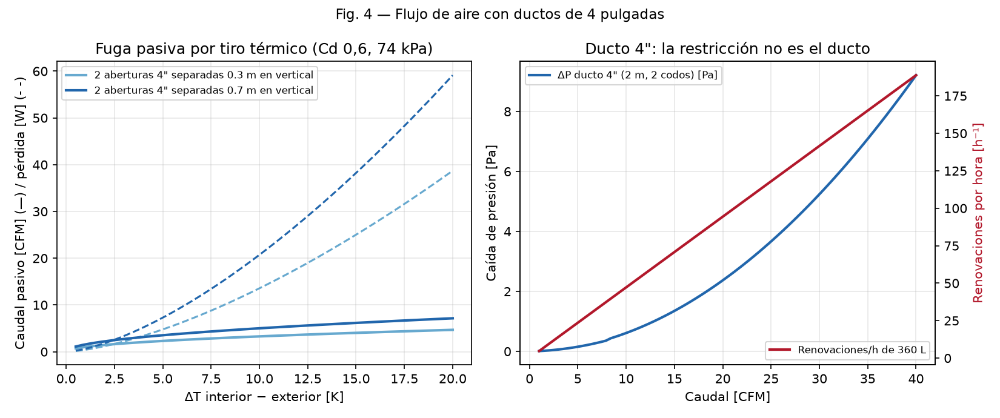

# Auditoría térmica — Guía experimental de incubadora de placas

**Este documento contiene predicciones de cálculo que sirven para fijar expectativas y límites de detención en los ensayos.** No autoriza energizar el calefactor, no aprueba una potencia ni una consigna, y no sustituye la revisión eléctrica que exige la sección 5 del borrador. La potencia definitiva se define por ensayo, como piden [incubation.md](../04_facility/incubation.md) y el propio borrador.

## Resumen

Como procedimiento de seguridad, el borrador es sólido:

- prohíbe energizar el calefactor;
- separa la medición en frío de la prueba con tensión;
- exige revisión de un electricista;
- reconoce que se aparta de la arquitectura de [incubation.md](../04_facility/incubation.md), que pide un PTC externo en plenum y calefacción fuera del volumen de bolsas.

Lo que falta es el análisis térmico. El borrador no indica la tensión de alimentación ni la potencia, ni la temperatura que alcanzará la placa, ni cuánto calor necesita la cámara. Este documento estima esos valores y deja abiertos como rangos los datos que todavía no se han medido.

## Supuestos

| Entrada | Valor usado | Estado |
|---|---|---|
| Sitio | Tenjo, ~2600 m s.n.m.: 73,7 kPa y ρ = 0,87 kg/m³ a 22 °C | Fórmula barométrica estándar |
| Tensión | 120 V (red en Colombia) | **No consta en el borrador** |
| Resistencia | 168 Ω, medida solo en el cable A | B sin medir |
| Lámina | Aluminio de 25 × 50 × 0,3 mm, k = 205 W/m·K | Aleación sin identificar |
| Emisividad | 0,05 (aluminio desnudo) y 0,9 (pintura mate) como contraste | Supuesto |
| Cámara | 80 × 50 × 90 cm interiores: A = 3,14 m² y V = 360 L | El borrador pide confirmar si son interiores |
| Aire interior | 22 °C, consigna experimental del borrador | No es un valor biológico aprobado |
| Puentes térmicos | +20 % sobre la UA de los paneles | Supuesto |

Para reproducir los cálculos: `python auditoria_termica_incubadora_placas_2026-11-01/modelo_termico.py` (requiere numpy y matplotlib).

## Hallazgos

### 1. Falta la tensión, y de ella depende todo (crítico)

| Conexión | Potencia | Densidad sobre 0,125 m² |
|---|---|---|
| Un cable a 120 V | **85,7 W** | **686 W/m²** |
| A + B en serie a 120 V, si B también mide 168 Ω | 42,9 W | 343 W/m² |
| A + B en paralelo a 120 V | 171,4 W | 1371 W/m² |
| Un cable a 12 V | 0,86 W | Irrelevante para calentar |

Los 86 W coinciden con la "Malla Radiante QuietWarmth (90 W, 120 V)" que figura en [environmental_control.md](../05_equipment/environmental_control.md). Ese mismo documento pide un "elemento de baja densidad de potencia superficial", y 686 W/m² no lo es.

**Acción:** registrar la tensión de alimentación y la procedencia de los cables A y B en la tabla de registro mínimo del borrador.

### 2. La placa se calienta demasiado sin ventilación forzada

Temperatura media de la placa, con aire a 22 °C. El cable queda más caliente que la placa.

| Caso | 43 W | 86 W | 171 W |
|---|---|---|---|
| Aire quieto, cara inferior sobre aislante, ε = 0,05 | 77 °C | **118 °C** | 190 °C |
| Aire quieto, placa suspendida, ε = 0,05 | 61 °C | **90 °C** | 141 °C |
| Aire quieto, placa suspendida, pintada mate (ε = 0,9) | 41 °C | 56 °C | 81 °C |
| Ventilador a 1 m/s rasante, ε = 0,05 | 51 °C | 76 °C | 123 °C |
| Ventilador a 2 m/s, flujo laminar (cota conservadora) | 45 °C | 67 °C | 107 °C |
| Ventilador a 2 m/s con turbulencia (h forzada × 2) | 34 °C | 47 °C | 71 °C |

Consecuencias:

- **Falla del ventilador.** Con un solo cable en aire quieto, la placa supera el límite de servicio de las espumas del inventario: Thermolon (PE), EPS y XPS, cuyo límite está entre 70 y 80 °C (XPS ~74 °C). El borrador ya prohíbe el contacto con EPS. Debe además especificar **qué hay debajo del cable**: si apoya sobre aislante, ese es el peor caso de la tabla.
- **El aluminio desnudo radia poco.** Con ε ≈ 0,05, casi todo el calor sale por convección. Pintar la cara expuesta de negro mate bajaría la placa unos 35 K a 86 W, pero hay que verificar que la pintura sea compatible con la temperatura y con el uso sanitario.
- **Hacen falta dos cortes térmicos.** El termostato bimetálico de 35 °C de environmental_control.md no protege la placa si está en el aire. Si se monta sobre la placa, corta durante la operación normal. Se necesitan:
  - un límite de aire de ~35 °C, ya que Abe et al. (2002) reportan daño biológico a 35 °C;
  - un límite de placa por debajo del límite de servicio del material más cercano. Por ejemplo, unos 60 °C si hay XPS o EPS a la vista, valor que debe fijar el técnico.
- **El ventilador es un componente de seguridad.** Con un cable, la placa queda por debajo de 70 °C solo si el ventilador garantiza 2 m/s o más. Su falla debe cortar la calefacción por un medio físico, no solo por el ESP32.

### 3. La configuración C2 resuelve un problema pequeño

- Con aire quieto, el calor se difunde unos **7,8 cm** hacia los lados en una lámina de 0,3 mm.
- Con un paso de serpentín de 4 cm, la falta de uniformidad en C1 es de ~3 %. Con 8 cm sube a ~13 %. La uniformidad solo es un problema si el paso supera unos 8 cm.
- A2 solo se apoya sobre A1, así que entre las dos queda una holgura de 0,1 a 1 mm. Eso equivale a una conductancia de contacto de 25 a 250 W/m²K.
  - Con esa holgura, A2 iguala la temperatura de la cara expuesta.
  - Pero **el cable se calienta un 9 % más con aire quieto y un 19 % más con ventilador** que en C1, en el extremo de 25 W/m²K.
- C2 no cambia la potencia por área, que es el problema dominante (hallazgo 2).

**Acción:** medir y fotografiar el paso del serpentín antes de dedicar ensayos a comparar C1 con C2.

### 4. La envolvente queda por debajo de la norma del KB

Conductancia térmica UA, con superficie interior aluminizada (h_i = 5 W/m²K), h_e = 8 W/m²K y +20 % por puentes térmicos:

| Envolvente | UA |
|---|---|
| Thermolon 15 mm sola | 5,2 W/K |
| Madera 12 mm + Thermolon 15 mm | 4,6 W/K |
| Madera 12 mm + Thermolon 15 mm + EPS 15 mm | 3,1 W/K |
| Norma del KB: madera 12 mm + 50 mm con λ = 0,035 | 2,0 W/K |

- [incubation.md](../04_facility/incubation.md) pide entre 25 y 50 mm de aislante con λ ≤ 0,035. En [materials.yaml](../metadata/materials.yaml) el único Thermolon registrado es de **15 mm**.
- El foil reflectivo solo reduce pérdidas si da hacia una cámara de aire. Pegado a otra capa no aporta resistencia térmica apreciable.
- Calor requerido para mantener 22 °C, sin contar el calor metabólico:

| Envolvente | 10 °C, sin ventilación | 10 °C, 10 CFM | 5 °C, sin ventilación | 5 °C, 10 CFM |
|---|---|---|---|---|
| Madera + Thermolon 15 | 56 W | 105 W | 79 W | 149 W |
| Madera + Thermolon 15 + EPS 15 | 37 W | 86 W | 52 W | 122 W |
| Norma del KB | 24 W | 74 W | 35 W | 105 W |

Con ventilación, un solo cable de 86 W no alcanza en noches frías. El dato que decide es el perfil del sitio de 14 días que exige incubation.md. Sin él no se puede elegir la potencia.

El calor metabólico de las bolsas reduce la demanda pero aumenta el riesgo de sobrecalentar el núcleo, en 4–8 °C según Shi et al. (2026), recogido en incubation.md. Este modelo no lo incluye.

### 5. Ventilación y ductos de 4"

- El rango de 8,5–13,6 CFM de environmental_control.md está escrito para "carpa o cámara". En 360 L, **10 CFM son unas 47 renovaciones por hora**. Su pérdida, 0,41 W/K por CFM, iguala la de toda la envolvente. Ese rango no debe trasladarse a esta cámara.
- Dos aberturas de 4" sin control y separadas 0,7 m en vertical dejan pasar por tiro térmico unos **5 CFM**, unos 21 W de pérdida con ΔT = 10 K. Con 0,3 m de separación son unos 3,3 CFM y 14 W.
- El ducto no restringe: con 10 CFM, la velocidad es de 0,58 m/s y la caída de presión de ~0,6 Pa en 2 m con dos codos. El problema es que la ventilación puede ser excesiva y no controlada, no que falte caudal.
- "No cerrar herméticamente" no basta como especificación. Las aberturas deben ser regulables y cerrables, y el caudal debe fijarse por el perfil de CO₂ con la cámara cargada, como pide incubation.md.

## Propuestas para el borrador

1. Agregar a la tabla de registro mínimo: tensión de alimentación, potencia calculada, resistencia de B, paso del serpentín y procedencia de los cables.
2. Especificar dos cortes térmicos independientes del ESP32, uno de aire y otro en la placa, e incluir en la sección 6 un ensayo de falla del ventilador.
3. Especificar el material que queda debajo del cable y el soporte, con una temperatura de servicio mayor que la que pueda alcanzar la placa con el ventilador detenido.
4. Evaluar menor densidad de potencia, por ejemplo A + B en serie distribuidos en dos láminas, o una cara expuesta mate antes de ensayar C2.
5. Declarar las aberturas de ventilación como regulables y cerrables, e incluir la ventilación prevista en los ensayos de 72 h.
6. Dejar la elección de potencia para después del perfil de 14 días, sin cambiar la secuencia de incubation.md.

## Límites del modelo

- **Correlaciones.** Placa horizontal con convección natural (Nu = 0,54 Ra^¼ para la cara superior y 0,27 Ra^¼ para la inferior), flujo laminar sobre placa plana y combinación cúbica de convección natural y forzada. El campo real del ventilador no está medido; por eso el caso turbulento ×2 se presenta como cota.
- **Placa isotérmica.** Para las temperaturas se usa la media de la placa. El cable y la zona junto a él están más calientes. El modelo no infiere la temperatura del conductor, que es una restricción explícita del borrador.
- **Lámina.** Aleta 1D de dos capas, sin resistencia de contacto entre el cable y A1.
- **Cámara en régimen permanente.** No incluye inercia ni calor metabólico.
- Las pérdidas de la envolvente usan el área interior, así que subestiman ligeramente la UA.
