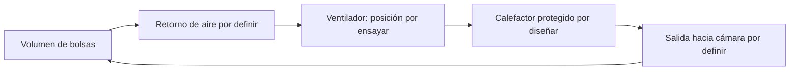

# Guía experimental de montaje en frío — incubadora de placas

**Borrador para revisión; no es un procedimiento de operación ni autoriza energizar el calefactor.** Esta guía registra la propuesta para evaluar materiales disponibles, no sustituye [incubación](../04_facility/incubation.md) ni [control ambiental](../05_equipment/environmental_control.md). El proyecto prefiere calefacción protegida fuera del volumen de bolsas. La placa y el compartimiento propuestos son una alternativa experimental cuya viabilidad, protecciones y compatibilidad siguen sin verificar.

## Materiales y nomenclatura

- Cámara descrita como 80 × 50 × 90 cm: confirmar si son dimensiones interiores. El volumen de 360 L solo aplica si lo son.
- A1 y B1: láminas de 25 × 50 cm, 0,3 mm nominales, cada una con cable existente debajo. A2 y B2: láminas adicionales.
- C1: A1 sola. C2: A1 con A2 apoyada encima. La sujeción de A2 debe ser reversible y no modificar el serpentín de A1.
- Una resistencia de 168 Ω fue comunicada para un cable; confirmar su identificación y medir ambas. No extrapolar el valor al segundo.
- Ventilador de 12 V, ESP32, SHT45 y sondas DS18B20: identificar unidades y estado. Soporte, resguardo y protecciones adecuados: **pendientes de inventario y revisión**.

## 1. Inspeccionar y medir con todo desconectado

1. Desconectar el calefactor de todas las fuentes. Fotografiar cada lámina, serpentín, fijación, terminación y cualquier daño.
2. En Ω, comprobar la lectura de puntas del multímetro; medir entre terminales del cable A y después del B. Registrar lecturas y temperatura ambiente. Una resistencia correcta **no demuestra aislamiento eléctrico seguro**.
3. Conservar A1 y su fijación intactas. No reparar ni energizar un cable dañado o sin terminaciones verificadas.

```text
A1: cara superior de aluminio
    ──────────────────────────
    ∿∿∿ cable existente debajo ∿∿∿

Conjunto desconectado: fotografiar y medir resistencia.
```

## 2. Presentar C2 y conservar C1

1. Apoyar A2 encima de A1. Comprobar planitud y documentar separaciones visibles desde los bordes.
2. Identificar posibles fijaciones, sin comprimir, perforar ni modificar el cable. Si no hay fijación apta, dejarla pendiente.
3. No introducir una sonda convencional entre las láminas: altera el contacto. No usar adhesivo ni pasta térmica sin verificar su aptitud.
4. A2 debe poder retirarse sin alterar A1. El contacto real y la presión de las fijaciones son variables de ensayo.

```text
C1                         C2
────────── A1              ────────── A2
∿∿∿ cable debajo          ────────── A1
                           ∿∿∿ cable debajo
```

## 3. Presentar cámara, soporte y circulación

Medir el interior y presentar el conjunto sin tensión; anotar distancias desde placa y cable al piso, paredes y futura carga. Los 5–9 cm mencionados como geometría preliminar **no son una separación de seguridad validada**. El soporte y el resguardo siguen por diseñar con fotografías y fichas; no deben permitir caída, contacto con bolsas o contacto con EPS.

Considerar una zona protegida de circulación separada de las bolsas; su geometría y materiales no están diseñados. No cerrar la cámara herméticamente ni cubrir filtros de bolsas. Una posible recirculación se representa de manera funcional, no dimensional:



Este esquema no determina aberturas, ventilación exterior, caudal ni compatibilidad eléctrica. La recirculación no sustituye el intercambio de aire necesario ni garantiza enfriamiento.

## 4. Ventilador y sensores

Identificar modelo y corriente del ventilador. Comparar en frío un flujo horizontal sobre la placa con el ventilador sobre la placa soplando hacia arriba; mantener entrada y salida libres, proteger aspas y sujetarlo independientemente. Probar a 12 V solo si la fuente y su entrada de red ya están instaladas de forma segura.

Identificar cada sonda física y marcar puntos de aire a altura de carga, superficie superior, extremos de placa, zona próxima al cable, piso aislado y ambiente exterior. Registrar coordenadas y método de fijación. No poner una sonda metálica en contacto con un cable cuyo aislamiento no esté validado. Comparar las sondas juntas y registrar offsets; el documento de incubación propone 48–72 h para DS18B20.

Para C1 y C2 mantener las coordenadas horizontales, ventilador, carga y condiciones de ensayo. El sensor de la cara superior necesariamente se traslada de A1 a A2: documentar el cambio. Si se usan rondas por falta de sondas, conservar una referencia fija y comparar solo cuando las condiciones sean comparables.

## 5. Puerta previa a una prueba energizada

Un electricista debe revisar y documentar: identificación, aislamiento y terminaciones del cable; continuidad de tierra de partes metálicas cuando corresponda; diferencial, sobrecorriente y desconexión; limitador térmico independiente, fusible térmico, ubicación de sus sensores; protección y comportamiento ante falla real del ventilador; soportes y materiales próximos. La clasificación del relé y la instalación de la fuente también requieren verificación. No se proporciona un circuito de red porque faltan esos datos.

**Si falta o falla una protección necesaria, detener la prueba con tensión.** Sí pueden continuar las mediciones desconectadas, fotografías, geometría y preparación del registro. ESP32, Wi‑Fi o un relé normalmente abierto no sustituyen las protecciones independientes.

## 6. Validación posterior a la revisión

Con límites de interrupción definidos por el técnico y fichas de los componentes, ensayar supervisadamente C1 y C2. Registrar potencia medida, ambiente, temperaturas del aire, placa, zona próxima al cable y aislamiento; detener ante cualquier falla de ventilación, sensor crítico, protección, olor, humo o deformación. No inferir temperatura del conductor a partir de una sonda cercana.

Luego ensayar con masa de agua y una disposición representativa. El agua muestra inercia y recuperación, pero no reproduce la geometría exacta ni el calor metabólico de las bolsas. Un ciclo biológico requiere especificación del lote, aprobación y vigilancia de aire y sustrato; 22 °C es únicamente una consigna experimental, no un valor biológico aprobado.

La [QuietWarmth Float](https://mpglobalproducts.com/floor-heating-systems/float/) se conserva intacta: su uso expuesto en la cámara no está validado. El fabricante limita el corte al largo y exige seguir su manual; no doblar ni instalar en paredes. No cortar antes de confirmar una aplicación compatible.

## Registro mínimo

| Campo | Valor |
|---|---|
| Fecha y responsable | Pendiente |
| Dimensiones interiores | Pendiente |
| Resistencia A / B y temperatura ambiente | Pendiente |
| Fotos y separación visible A1/A2 | Pendiente |
| Fijaciones, soporte y distancias | Pendiente |
| Ventilador y puntos/identificadores de sensores | Pendiente |
| Protecciones existentes y revisión profesional | Pendiente |
| Condición para prueba energizada | Bloqueada hasta verificación documentada |
