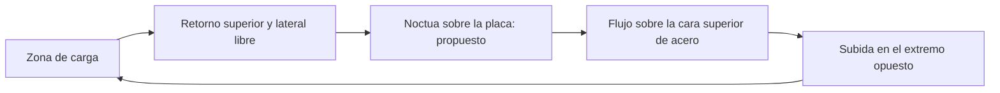

# Guía experimental de montaje en frío — incubadora de placas

**Borrador para revisión; no es un procedimiento de operación ni autoriza energizar el calefactor.** Esta guía registra la propuesta para evaluar materiales disponibles, no sustituye [incubación](../04_facility/incubation.md) ni [control ambiental](../05_equipment/environmental_control.md). El proyecto prefiere calefacción protegida fuera del volumen de bolsas. La placa y el compartimiento propuestos son una alternativa experimental cuya viabilidad, protecciones y compatibilidad siguen sin verificar.

## Materiales y nomenclatura

**Procedencia y alcance de la revisión (2026-11-08).** Se revisaron los chats «SOL 6.1 — Calefacción incubadora» y «Crear manual técnico de incubadora», incluida su guía Rev7 y guía rápida Ed4. Las aclaraciones del propietario en el chat «Wire sensors to the módulos of setas OS» prevalecen para describir el montaje actual. Son datos comunicados por el propietario; no constituyen una inspección presencial ni mediciones certificadas. Las propuestas anteriores no se presentan como elementos ya instalados.

- Dimensiones interiores comunicadas: **90 × 60 × 80 cm**, interpretadas como largo × ancho × alto. Volumen geométrico calculado: **432 L**, antes de descontar componentes y carga. Confirmar los puntos de medición; no equivale al volumen útil para bolsas.
- Superficie calefactora: **cuatro láminas de aluminio contiguas**, que el propietario indica que cubren la base. Encima descansan directamente **dos láminas de acero contiguas**, sin separadores, formando la misma superficie conjunta. Las cotas anteriores de 25 × 50 cm por lámina no permiten justificar por sí solas la cobertura actual de 90 × 60 cm: medir las piezas, juntas y superficie realmente cubierta. Espesores actuales por verificar.
- **Dos cables iguales, de unos 5 m**, fijados homogéneamente en serpentinas bajo el aluminio, conectados **en serie a 120 V**, según el propietario. Una resistencia de **168 Ω** fue medida en un solo cable. Suponiendo igual resistencia en el segundo: 336 Ω totales, 0,357 A y **42,9 W totales**; es una estimación eléctrica, no consumo medido ni aprobación térmica.
- La [publicación original del cable](https://www.mercadolibre.com.co/resistencia-electrica-de-silicona-incubadora-100w-110220v/up/MCOU2590062546?pdp_filters=item_id:MCO532589727), consultada el 2026-11-08, mezcla un título de 100 W con 74 W a 110 V y menciona tanto 5 m como 5,2 m y 33 Ω/m. Sus datos de aislamiento y temperatura son declaraciones comerciales sin validación del montaje. No trasladar la temperatura anunciada al aluminio, acero, madera, PVC o aislamiento.
- Separación comunicada: **10 cm libres desde el punto más bajo del cable hasta el Mylar del piso**. Es una cota geométrica, no una distancia de seguridad validada.
- Apoyo de las láminas: **bloques de madera en zonas sin cable**. Hay tres varillas metálicas en un riel protegido, sin contacto directo con aluminio o acero según el propietario. El material, la unión y el recorrido de cargas del riel necesitan documentación; identificar la cinta descrita como «para calor». No se presupone aislamiento eléctrico ni aptitud térmica de esa cinta o de la madera.
- Paredes sujetas por perfiles de aluminio en L en las esquinas; **las L sostienen solo las paredes**, no el conjunto calefactor. Envolvente con cielorraso de PVC blanco revestido interiormente de Mylar. Compatibilidad con temperatura, adhesivos y fijaciones pendiente.
- Piso, de arriba abajo: Mylar → EPS de 2 cm → EPS de 2 cm → EPS de 1,5 cm → Yumbolón → colchoneta de camping → Yumbolón → colchoneta de camping. Cinta de gotera aluminizada refuerza el exterior; no se le atribuye función estructural, ignífuga o dieléctrica. El conjunto se apoya en **cuatro bloques de vidrio acostados**, con su cara de vidrio hacia arriba. Base rígida de reparto y ubicación de apoyos por comprobar.
- El [Yumbolón enlazado](https://www.homecenter.com.co/homecenter-co/product/3093417/aislante-termico-3mm-122mx10m-1-cara-aluminio-yumbolon/3093417/) declara polietileno y 3 mm por capa; la [colchoneta enlazada](https://www.homecenter.com.co/homecenter-co/product/162919/aislante-termico-para-camping-180-x-50-cm/162919/) declara 6 mm por capa. Con las tres capas de EPS comunicadas, la suma nominal es **7,3 cm**, sin Mylar, cinta ni compresión; falta medición del conjunto. El [bloque Holztek](https://www.homecenter.com.co/homecenter-co/product/79180/bloque-vidrio-19x19x8cm-transparente-holztek/79180/) mide nominalmente 19 × 19 × 8 cm y tiene cámara de aire; la ficha consultada no valida su capacidad como apoyo horizontal de esta incubadora.
- Tapa: **unos 10 cm de espesor total**, incluyendo las capas, con icopor y materiales aislantes del mismo tipo que el piso, y protección superior de PVC de cielorraso cortado a medida. No interpretar esta cota como 10 cm de EPS más revestimientos; espesores y orden de la tapa por verificar.
- **Estado actual:** Inkbird con sonda usado para mediciones preliminares; modelo y posición de sonda por registrar. No se presupone que controle los cables. **No hay ventilador instalado.** Se selecciona un Noctua de 12 cm del inventario para preparar la circulación; comprobar la variante exacta de la unidad.

**Herramientas y materiales para presentar el montaje en frío.** Preparar multímetro, cinta métrica, elementos de rotulado, cámara, herramientas de fijación y cableado adecuadas, ordenador y cable USB de datos para el ESP32. Reservar del inventario ESP32, SHT45 protegido, Noctua, gabinete y pasamuros, conectores y fuentes compatibles; identificar sus unidades físicas. Las fuentes Mean Well de 12 V no alimentan directamente los pines lógicos del ESP32. Sondas DS18B20, resistencia de 4,7 kΩ si el bus no la incorpora, protección del SHT45, soporte/resguardo del ventilador y protecciones térmicas independientes siguen pendientes de existencia o selección. No convertir esta lista en una orden de compra: verificar primero lo disponible y la necesidad de cada componente.

## 1. Inspeccionar y medir con todo desconectado

1. Desconectar el conjunto calefactor de todas las fuentes. Fotografiar las dos capas metálicas, las serpentinas, sus fijaciones y terminaciones, madera, riel, varillas y aislamiento. Rotular los cables como A y B, sin atribuir a ambos la medición de uno solo.
2. En Ω, comprobar la lectura de puntas del multímetro; medir y registrar cada cable y, cuando pueda hacerse sin alterar conexiones inseguras, el conjunto en serie. Anotar temperatura ambiente. Una resistencia correcta **no demuestra aislamiento eléctrico seguro**; su comprobación corresponde a la revisión técnica.
3. Conservar las fijaciones intactas. No reparar ni energizar un cable dañado o con terminaciones sin verificar. Documentar dónde tocan los bloques de madera el aluminio y la separación real del cable a cada material cercano.

```text
Dos láminas de acero contiguas
Cuatro láminas de aluminio contiguas
Cable A y cable B en serpentinas debajo del aluminio
Apoyos de madera únicamente en zonas sin cable
10 cm libres: punto inferior del cable → Mylar
Piso multicapa → cuatro bloques de vidrio
```

## 2. Verificar las capas y sus apoyos

1. Presentar las cuatro piezas de aluminio contiguas y las dos de acero sobre ellas. Registrar medidas de cada pieza, juntas, planitud y contacto real. El acero descansa directamente sobre el aluminio; no se propone añadir pasta, adhesivo ni otra capa.
2. Identificar fijaciones que eviten desplazamiento o caída sin perforar, comprimir ni pinzar el cable. La ausencia de cable bajo la madera no valida la temperatura del apoyo: incluir esos puntos en la revisión y futura instrumentación.
3. Documentar el riel protegido y sus tres varillas sin asignarles una función estructural no comprobada. Verificar estabilidad y reparto de cargas del piso sobre los cuatro bloques de vidrio; falta caracterizar una base rígida de reparto. No cargar bolsas para dar por probado el soporte.
4. No introducir una sonda convencional entre acero y aluminio: alteraría el contacto. Reservar puntos de medición accesibles en la cara superior, cerca del cable sin tocarlo eléctricamente, en apoyos de madera y piso aislado.

```text
VISTA FUNCIONAL DE CAPAS, SIN ESCALA
Acero: dos piezas juntas, apoyadas directamente
Aluminio: cuatro piezas juntas
Serpentinas bajo el aluminio; apoyos en zonas sin cable
No se representa un circuito de conexión de 120 V
```

La comparación histórica C1/C2 (una o dos láminas de aluminio superpuestas) **no describe el montaje actual** y deja de ser la secuencia de armado de esta guía. Tampoco se transfieren a la geometría de 90 × 60 × 80 cm las temperaturas o densidades de potencia calculadas para la placa anterior de 25 × 50 cm. Los documentos históricos se conservan como antecedentes, no como validación del conjunto corregido.

## 3. Presentar cámara, soporte y circulación

Medir el interior y registrar distancias desde cable y metales a piso, paredes, apoyos y futura carga. Mantener los **10 cm desde cable a Mylar** como dato comunicado; no confundirlos con altura de placa, espesor del piso o separación térmica aprobada. Verificar el resguardo frente a contacto con bolsas o caída de piezas. El Mylar, el PVC y las espumas no se convierten en protecciones contra incendio por ser reflectantes o aislantes.

Los chats anteriores ya indicaban la placa al ras de las paredes. Para esa geometría, presentar el **Noctua por encima del conjunto metálico, vertical y con descarga horizontal sobre la cara superior de acero**, en un soporte independiente con aspas protegidas. Dejar libres aspiración hacia el interior, salida, paso ascendente en el extremo contrario y retorno alrededor de la carga. Su ubicación y holguras siguen pendientes de ensayo; no son una posición óptima demostrada. No perforar ni recortar las placas para reproducir el dibujo.



Esta recirculación propuesta **no ventila directamente el cable bajo el aluminio**. No hay pasos de ida y retorno comprobados entre la zona inferior y la superior. La recirculación tampoco sustituye el intercambio exterior necesario para retirar calor y CO₂. Aberturas y extracción siguen pendientes de definir; no operar herméticamente con carga biológica.

## 4. Ventilador y sensores

Identificar el Noctua de 12 cm seleccionado y contrastar su etiqueta con el NF-P12 del inventario. El propietario confirmó que todavía no está instalado. Sujetarlo independientemente de las láminas y con cables fuera de la zona caliente. Comprobar tensión, corriente, conector y tacómetro de la unidad antes de alimentarlo desde una fuente adecuada; el diseño requiere detectar su parada, no limitarse a enviar una orden de encendido.

El **Inkbird actual es una referencia de medición preliminar**. Registrar modelo, posición y resultados; no asumir que corta el calefactor. El control previsto usa **SHT45 protegido → ESP32/ESPHome → relé adecuado → dos cables en serie**. El ESP32 manda la señal del relé; no alimenta los cables de 120 V. La clasificación, polaridad, aislamiento y alimentación del relé requieren verificación técnica antes de adaptar el circuito real.

Mantener el lazo de control en el ESP32, con respuesta segura ante sensor inválido, ventilador detenido, sobretemperatura y corte/retorno de energía. Home Assistant y Setas OS supervisan y registran; no sustituyen el control local ni los cortes térmicos físicos. No fijar una consigna biológica ni reutilizar umbrales de otro lote por defecto. El archivo de control del piloto es de banco, contiene parámetros y direcciones por completar y no se carga directamente como adaptación aprobada a esta incubadora.

Identificar cada sonda física y marcar aire a altura de carga, cara superior de acero, extremos y juntas, zona próxima al cable, apoyos de madera, Mylar del piso y ambiente exterior. No poner una sonda metálica en contacto con un cable cuyo aislamiento no esté validado. Comparar las sondas juntas y registrar offsets; el documento de incubación propone 48–72 h para DS18B20. Mantener coordenadas y condiciones de carga comparables entre ensayos; una sola sonda de aire no califica la zona del cable ni los apoyos.

**Instrumentación disponible e integración propuesta con Setas OS.** La asignación se basa en el [inventario de equipos](../metadata/equipment.yaml); es evidencia documental de disponibilidad, no una verificación física del montaje. El [diseño de sensores y materiales](../../field-os-simulador/setas-os/telemetry-publisher/hardware-design.md) conserva las cantidades, reservas y contradicciones detectadas en el repositorio.

| Elemento para la incubadora | Asignación propuesta y condición previa |
|---|---|
| Aire: temperatura y HR | Un SHT45 breakout de los dos registrados. Instalar únicamente después de comprobar membrana o capuchón protector equivalente; no exponer la placa desnuda al ambiente húmedo. |
| Nodo de lectura | Uno de los tres ESP32-WROOM-32. Identidad lógica propuesta: `setas-incubacion-01`; verificar y registrar qué unidad física recibe ese nombre. |
| Gabinete y alimentación | Los dos TICONN documentados están propuestos para Martha y Cloudlab; el gabinete del tercer nodo sigue pendiente. Verificar alimentación del ESP32 y protección del conjunto. Las fuentes Mean Well registradas son de 12 V: no conectarlas directamente a los pines de alimentación lógica. |
| Mapa térmico y núcleo | No se confirmó stock de DS18B20 ni direcciones de sondas. Las exigencias de calificación siguen vigentes; el SHT45 de aire no las sustituye. No habilitar lecturas de núcleo o sustrato a partir de valores de ejemplo. |
| CO₂ | El único MH-Z19C registrado está propuesto para Cloudlab. No asignar CO₂ a esta incubadora por defecto. La propiedad de SCD30 sigue en contradicción entre documentos y no se presupone resuelta. |

**Actualización 2026-11-12 (DEC-023):** el propietario decidió no usar sondas de núcleo ni DS18B20 por ahora. Los puntos de medición de superficie indicados arriba (acero, extremos, juntas, apoyos de madera, piso) se toman a mano con termómetro infrarrojo sobre parches fijos de cinta mate, y cada bolsa en un punto marcado. Son lecturas comparativas, no temperatura de núcleo, y no sustituyen las protecciones de la sección 5.

El perfil [esphome-incubacion.yaml](../../field-os-simulador/setas-os/telemetry-publisher/esphome-incubacion.yaml) propone I²C con SDA en GPIO21, SCL en GPIO22 y dirección `0x44`. Confirmar el pinout y la alimentación de la sonda concreta antes de conectar; estos valores de firmware no identifican colores ni terminales de un cable físico. El perfil es **solo de telemetría**: no reemplaza el firmware de control térmico ni añade acciones de relé.

La ruta propuesta es **SHT45 → ESP32/ESPHome → HTTPS en Raspberry Pi Zero 2 W → Firestore → Módulos de Setas OS**. El Pi 4 conserva su función de Home Assistant. El sistema operativo, alimentación, almacenamiento, dirección de red y certificado del Pi Zero aún requieren verificación; su existencia en inventario no demuestra que el publicador esté instalado.

Para preparar y comprobar la conexión:

1. Montar e identificar el sensor protegido y el nodo, con el calefactor desconectado. Registrar posición, fijación e identificación física; conservar la comparación de sondas indicada arriba.
2. Seguir la [configuración del publicador](../../field-os-simulador/setas-os/telemetry-publisher/README.md). En su archivo privado, vincular `setas-incubacion-01` con `incubacion_01`. Mantener credenciales fuera del repositorio; el arranque con identidad de servicio y el flasheo requieren aprobación humana. No utilizar los binarios de validación, que contienen secretos sintéticos.
3. Confirmar que `telemetria_salas/incubacion_01` recibe `metric_readings.temperature_c` y `metric_readings.rh_pct`, cada uno con su unidad, dispositivo y hora de observación. El perfil registra la hora al recibir cada muestra del sensor; retransmitir un valor guardado no lo convierte en una observación nueva.
4. Comprobar que esas mismas lecturas aparecen en el módulo de incubación, sin CO₂ ni temperatura de sustrato inventados. Interrumpir la señal de forma controlada y verificar que la lectura envejece y se indica como antigua. Si falla la conexión, detener la puesta en servicio de la telemetría y registrar el fallo; no modificar el control térmico para compensarlo.

**Estado de validación:** los tres perfiles propuestos, incluido el de incubación, pasaron validación de configuración y compilación completa con ESPHome 2026.10.2 y ESP-IDF 5.5.6 el 2026-11-08; ver [evidencia de compilación](../../field-os-simulador/setas-os/telemetry-publisher/firmware-validation.json). Se usaron secretos de prueba. No se realizó flasheo, puesta en servicio del publicador ni verificación de lecturas físicas. Esta integración no cierra la puerta eléctrica de la sección 5 ni la calificación térmica de la sección 6.

## 5. Puerta previa a una prueba energizada

Un electricista debe revisar y documentar: identificación, aislamiento y terminaciones del cable; continuidad de tierra de partes metálicas cuando corresponda; diferencial, sobrecorriente y desconexión; limitador térmico independiente, fusible térmico, ubicación de sus sensores; protección y comportamiento ante falla real del ventilador; soportes y materiales próximos. La clasificación del relé y la instalación de la fuente también requieren verificación. No se proporciona un circuito de red porque faltan esos datos.

**Si falta o falla una protección necesaria, detener la prueba con tensión.** Sí pueden continuar las mediciones desconectadas, fotografías, geometría y preparación del registro. ESP32, Wi‑Fi o un relé normalmente abierto no sustituyen las protecciones independientes.

## 6. Validación posterior a la revisión

Con límites de interrupción definidos por el técnico y fichas de los componentes, ensayar supervisadamente el conjunto actual de acero, aluminio y dos cables en serie. No modificar simultáneamente soporte, ventilador, carga y control durante una comparación. Registrar potencia medida, ambiente, temperaturas del aire, placa, zona próxima al cable y aislamiento; detener ante cualquier falla de ventilación, sensor crítico, protección, olor, humo o deformación. No inferir temperatura del conductor a partir de una sonda cercana.

Luego ensayar con masa de agua y una disposición representativa. El agua muestra inercia y recuperación, pero no reproduce la geometría exacta ni el calor metabólico de las bolsas. Un ciclo biológico requiere especificación del lote, aprobación y vigilancia de aire y sustrato; 22 °C es únicamente una consigna experimental, no un valor biológico aprobado.

La [QuietWarmth Float](https://mpglobalproducts.com/floor-heating-systems/float/) se conserva intacta: su uso expuesto en la cámara no está validado. El fabricante limita el corte al largo y exige seguir su manual; no doblar ni instalar en paredes. No cortar antes de confirmar una aplicación compatible.

## Registro mínimo

| Campo | Valor |
|---|---|
| Fecha y responsable | Pendiente |
| Dimensiones interiores | 90 × 60 × 80 cm comunicados; 432 L geométricos calculados, no volumen útil |
| Resistencia A / B y temperatura ambiente | 168 Ω en un cable, según propietario; segundo y total por medir. Dos cables iguales en serie a 120 V; unos 43 W estimados |
| Capas y contacto | Cuatro aluminios contiguos + dos aceros en contacto directo; dimensiones, espesores y juntas por medir |
| Fijaciones, soporte y distancias | Madera en zonas sin cable; riel y tres varillas; 10 cm cable–Mylar comunicados. Estabilidad/aptitud pendientes |
| Ventilador y sensores actuales | Noctua 12 cm seleccionado, no instalado. Inkbird para medición preliminar; posiciones/modelos por registrar |
| Nodo físico / identidad lógica / módulo Setas OS | Pendiente; propuesta: `setas-incubacion-01` / `incubacion_01` |
| Protección del SHT45, gabinete y alimentación del nodo | Pendiente de verificación física; control ESP32/relé aún por integrar y validar |
| Telemetría real: hora de muestra, recepción y envejecimiento | Pendiente; compilación de prueba no equivale a conexión física |
| Protecciones existentes y revisión profesional | Pendiente |
| Condición para prueba energizada | Bloqueada hasta verificación documentada |
